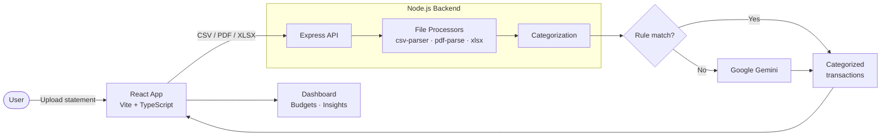

<div align="center">

# FinPal

**AI-powered personal finance for UPI users. Analyze spending, manage budgets, and simulate investments in one dashboard.**


</div>

---

## Overview

FinPal turns raw UPI transaction history into clear financial insight. Upload statements from GPay, PhonePe, or your bank, and FinPal categorizes every transaction, tracks your budgets, and helps you plan investments, all in a fast, mobile-friendly dark-theme dashboard.

---

## Features

| Feature | Description |
|---------|-------------|
| **UPI Transaction Analysis** | Upload and parse history from GPay, PhonePe, and bank statements (CSV, PDF, Excel) |
| **Hybrid Categorization** | Rule-based classification first, with Google Gemini as the AI fallback |
| **Live Dashboard** | Income, expenses, savings, and budget status at a glance |
| **Budget Management** | Spending limits with progress bars and alerts |
| **Investment Simulator** | SIP and FD return calculators using compound interest |
| **AI Insights** | Personalized spending analysis and budget suggestions |
| **Modern UI** | Responsive layout, glassmorphism design, smooth Framer Motion animations |

---

## Pages and Status

| Page | Route | Status | What it does |
|------|-------|--------|--------------|
| **Homepage** | `/` | Ready | Hero, feature highlights, statistics, testimonials, call to action |
| **Dashboard** | `/dashboard` | Ready | Overview cards, trend and category charts, budget progress, recent transactions |
| **Transactions** | `/transactions` | Placeholder | File upload and transaction management |
| **Budgets** | `/budgets` | Placeholder | Create and monitor budgets |
| **AI Insights** | `/ai-insights` | Placeholder | Gemini-powered analysis and chat |
| **Investments** | `/investments` | Placeholder | SIP calculators and portfolio comparison |

---

## How It Works



1. The user uploads a statement in the React app.
2. The Express server parses the file into transactions.
3. Each transaction is categorized by rules first. Only unmatched ones go to Gemini, which keeps AI usage low.
4. Results return to the app and power the dashboard, budgets, and insights.

---

## Tech Stack

| Layer | Technologies |
|-------|--------------|
| **Frontend** | React 18, TypeScript 5.5, Vite, React Router 6 |
| **State & Data** | TanStack React Query |
| **Styling & UI** | Tailwind CSS, shadcn/ui, Radix UI, Framer Motion, Lucide icons |
| **Charts** | Recharts |
| **Forms** | React Hook Form, Zod |
| **Utilities** | date-fns, react-dropzone, sonner, clsx, tailwind-merge |
| **Backend** | Node.js, Express 4.18, Multer, CORS, dotenv |
| **File Parsing** | csv-parser, pdf-parse, xlsx |
| **Tooling** | Vitest, Prettier, ESLint, Nodemon |

---

## Quick Start

### Prerequisites

- Node.js 18 or later
- npm

### Install and run

```bash
# 1. Install dependencies
npm install

# 2. Start the development server
npm run dev
```

Open the URL shown in the terminal (Vite usually uses [http://localhost:5173](http://localhost:5173)).

### Other commands

| Command | Description |
|---------|-------------|
| `npm run dev` | Start the development server |
| `npm run build` | Create a production build |
| `npm run typecheck` | Check TypeScript types |
| `npm test` | Run unit tests with Vitest |

---

## Project Structure

```
FinPal/
├── src/                     # Frontend
│   ├── components/
│   │   ├── ui/              # shadcn/ui components
│   │   ├── layout/          # Sidebar and navigation
│   │   └── charts/          # Chart components
│   ├── pages/               # Route pages
│   ├── hooks/               # Custom React hooks
│   ├── lib/                 # Utilities and configuration
│   └── App.tsx              # App entry
├── server/                  # Backend
│   ├── processors/          # CSV, PDF, and Excel processors
│   └── server.js            # Express server
├── public/                  # Static assets
└── (config files)           # Vite, Tailwind, TypeScript
```

---

## Design System

| Role | Color |
|------|-------|
| **Primary (purple gradient)** | `#8b5cf6` → `#7c3aed` → `#6d28d9` |
| **Background (dark)** | `#0f0f23` → `#1a1a3a` → `#252547` |
| **Glass effect** | `rgba(255, 255, 255, 0.05 – 0.1)` |
| **Success / Income** | `#10b981` |
| **Warning** | `#f59e0b` |
| **Error / Expenses** | `#ef4444` |
| **Info** | `#3b82f6` |

**Principles:** mobile-first, accessible (semantic HTML and ARIA), full TypeScript coverage, reusable components, and graceful error states.

---

## Roadmap

- [x] Homepage and dashboard
- [x] Responsive dark theme with glassmorphism
- [ ] Transactions page with file upload
- [ ] Budget creation and alerts
- [ ] Gemini integration for AI insights and chat
- [ ] Investment calculators (SIP and FD)
- [ ] User authentication (JWT)
- [ ] MongoDB persistence
- [ ] PDF and CSV report export
- [ ] Real-time notifications
- [ ] Portfolio performance tracking

---

## License

Released under the [MIT License](./LICENSE).

---

<div align="center">

Built with ❤️ for Indian UPI users seeking better financial insights.

</div>
